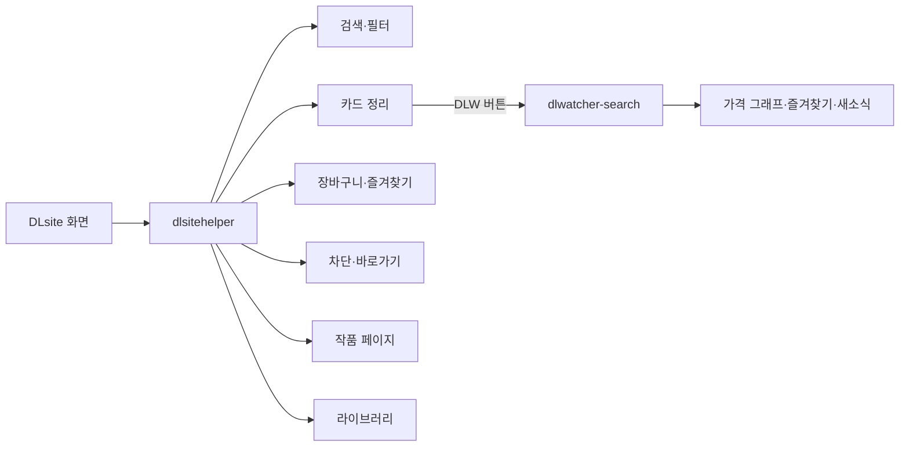
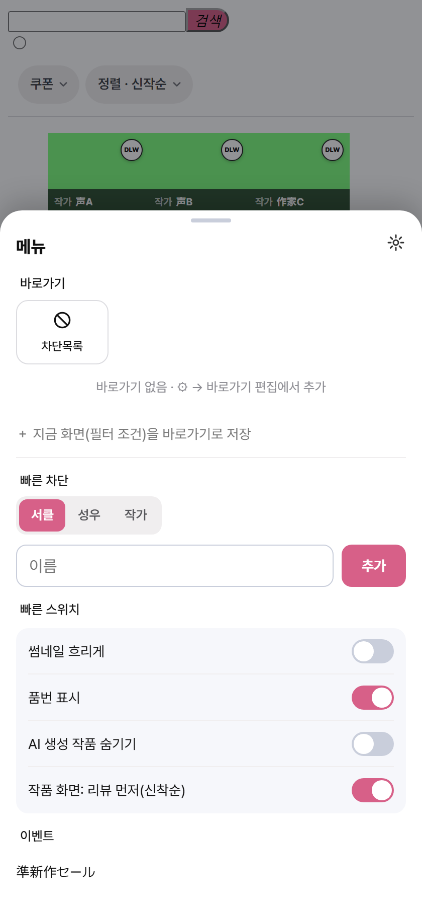
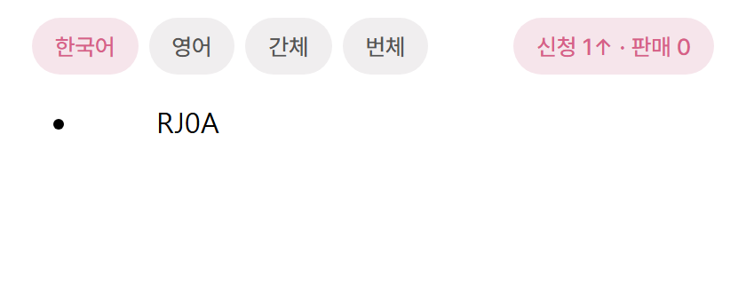
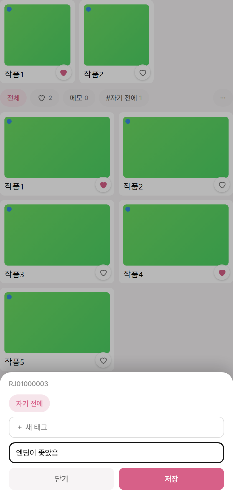

# dl-helper

개인용 유저스크립트 두 개. 비공식이며 DLsite·dlwatcher와 관계없습니다. 이 폴더는 백업을 겸해 자동으로 갱신됩니다.

## 설치 (폰)
1. Firefox 또는 삼성 인터넷에서 **Tampermonkey** 부가기능을 설치합니다.
2. 아래 링크를 엽니다. Tampermonkey 설치 화면이 뜨면 **설치**를 누릅니다. (설치 화면이 안 뜨고 글자만 보이면 전체 복사해서 Tampermonkey → 새 스크립트에 붙여넣기)
   - DLsite: https://raw.githubusercontent.com/flzhdlqslek/dl-helper/main/dlsitehelper.user.js
   - dlwatcher: https://raw.githubusercontent.com/flzhdlqslek/dl-helper/main/dlwatcher-search.user.js
3. 이후 새 버전은 Tampermonkey가 자동으로 받습니다(기본 하루 한 번 확인).
4. 처음 한 번, 사이트의 성인 확인 창은 직접 눌러야 합니다.

PC는 Chrome/Edge에 Tampermonkey를 설치하고 같은 링크를 열면 됩니다.

## 한눈에

## dlsitehelper
- **검색·필터**: 한국어·신작순 기본. 형식·언어·가격·할인·태그를 한 창에서. TL/BL 전환, 번역 허가 목록(언어별 신청 1↑·판매 0)
- **카드 정리**: 쿠폰·묶음·할인율·마감·품번 딱지를 형식 줄에 모아서, DLW 버튼(짧게 = dlwatcher, 꾹 = 품번 복사)
- **장바구니·즐겨찾기**: 고르기, 마감순
- **차단·바로가기**: 서클·성우·작가 차단, 이름을 꾹 누르면 검색어 저장·차단, 한/일 알약 꾹 누르면 빠른 메뉴
- **작품 페이지**: 리뷰 먼저(신착순), 번역 허가 ○/✕
- **라이브러리**: ♡·내 태그·메모(이 기기에 저장, 내보내기/가져오기)
- 요청 수를 늘리지 않는 것을 원칙으로 합니다.

## dlwatcher-search
- 품번·서클·성우·작가 검색, 가격 그래프(번역판은 원본 기록), 즐겨찾기, 새소식
- DLW 버튼으로 들어오면 그래프까지 작은 팝업으로 보이고, 여백을 누르면 돌아갑니다.

## 화면 (가짜 데이터로 찍은 참고용)
| 한/일 알약 꾹 누르기 메뉴 | 번역 허가 목록 칩 | 라이브러리 ♡·태그·메모 |
|---|---|---|
|  |  |  |

## 주의
- 개인 사용 목적이며 보증하지 않습니다. 사이트 구조가 바뀌면 동작하지 않을 수 있습니다.
- 사이트 이용약관을 지키고, 과도한 요청을 보내지 않도록 쓰세요.
